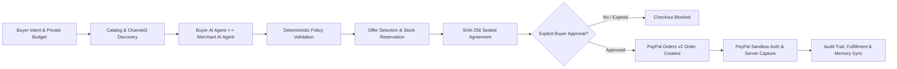
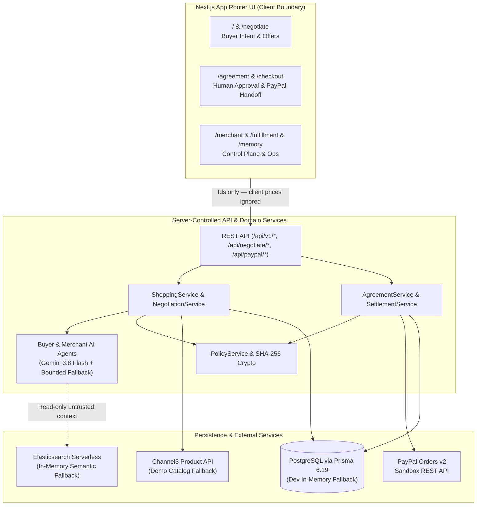
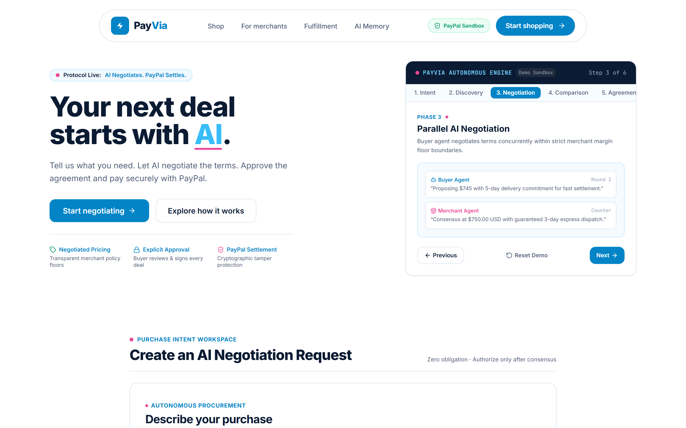
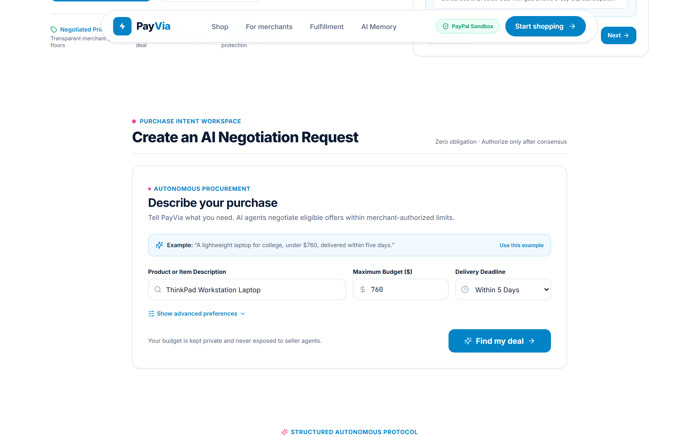
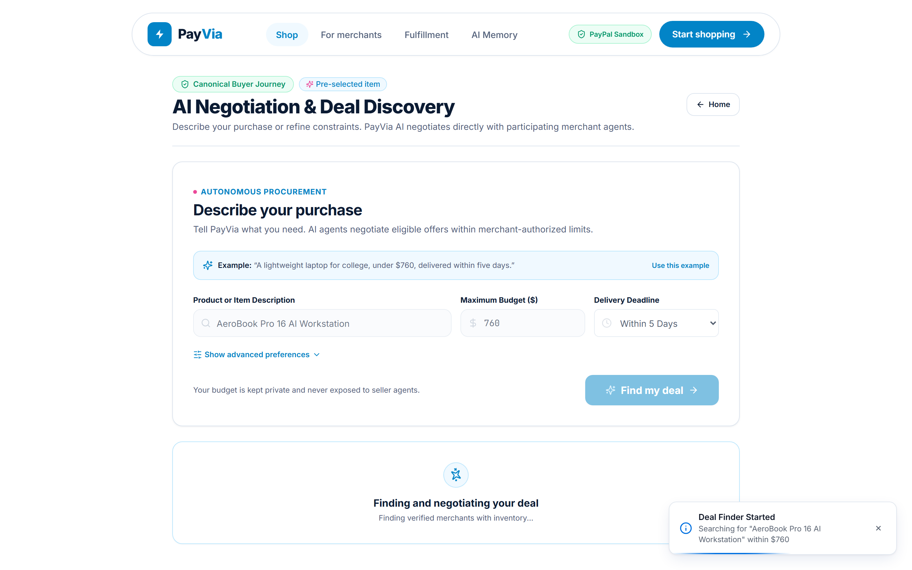
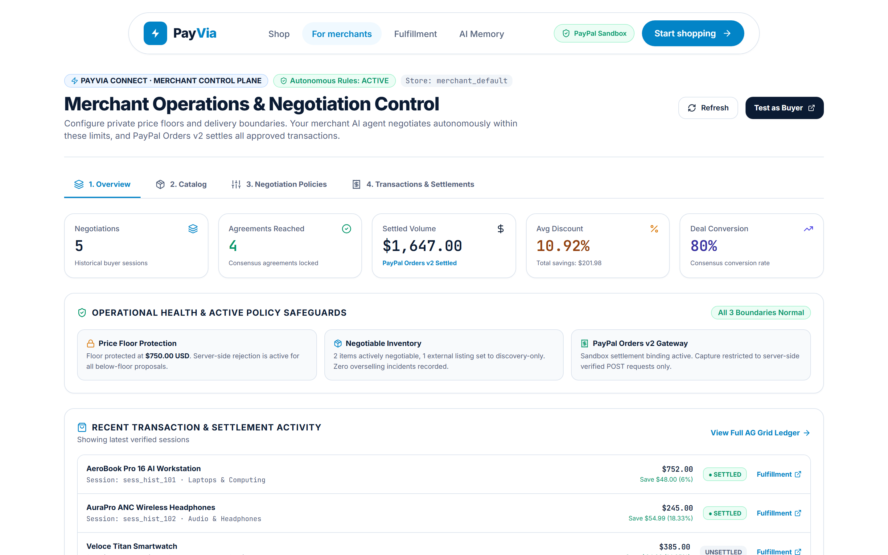
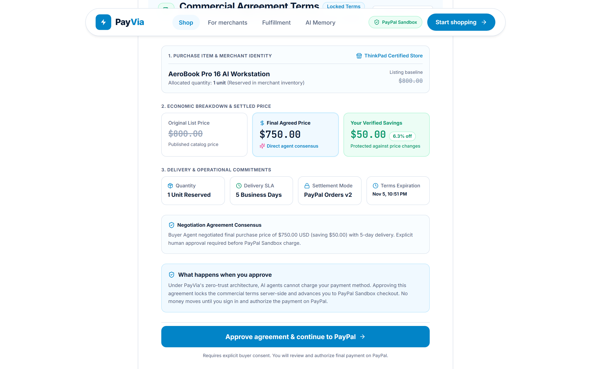
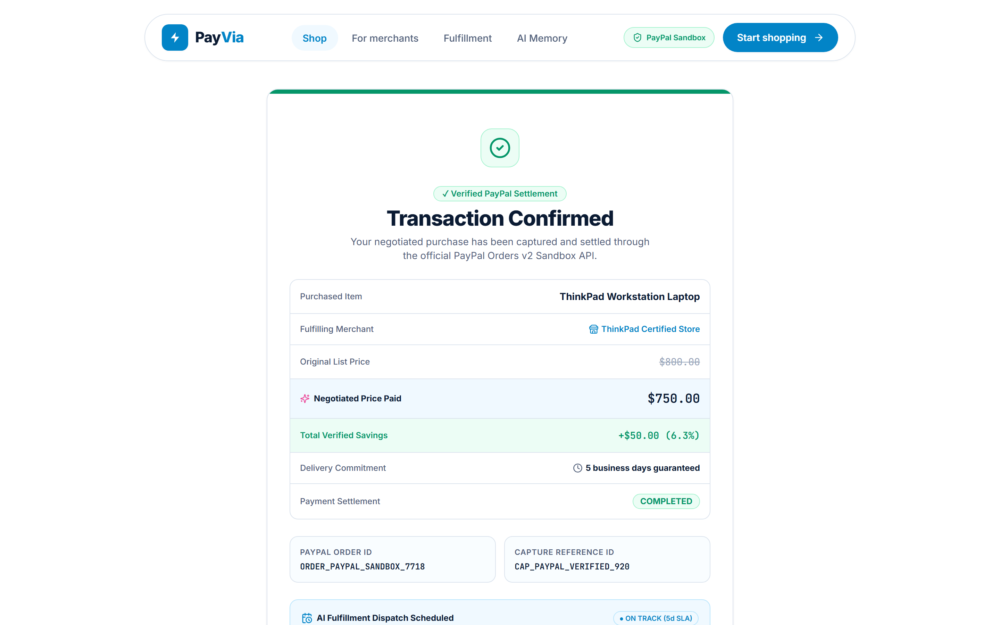
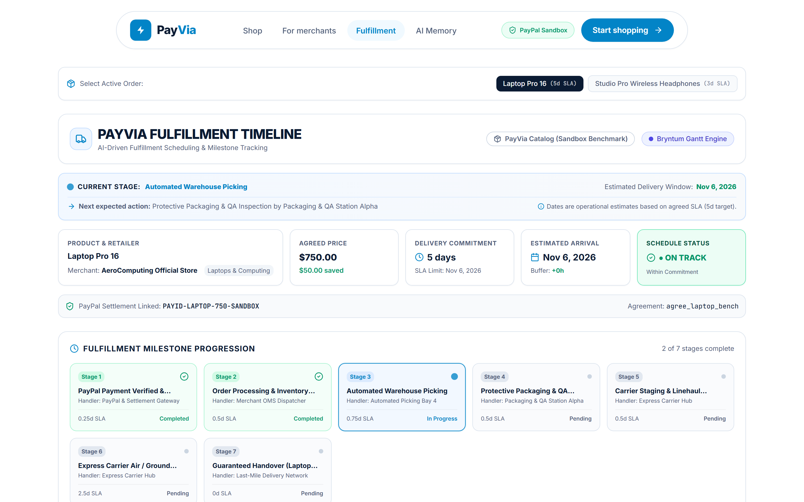

<div align="center">

# ⚡ PayVia

### **AI negotiates. PayPal settles.**

**Autonomous Agent-to-Agent Commerce Negotiation & Verified PayPal Orders v2 Settlement Platform**<br />
*Built for the PayPal Hackathon*

[](https://nextjs.org/)
[](https://www.typescriptlang.org/)
[](https://www.prisma.io/)
[](https://developer.paypal.com/)
[](https://ai.google.dev/)
[](./LICENSE)

[How It Works](#how-it-works) • [Architecture](#system-architecture) • [PayPal Settlement](#paypal-integration) • [Security](#security-and-financial-safeguards) • [Screenshots](#project-screenshots) • [Local Setup](#local-development-setup)

</div>

---

## The Problem

Digital commerce operates on take-it-or-leave-it checkout pricing. In contrast, real-world purchasing routinely involves flexible negotiation over price, delivery speed, and payment timing.

Giving a single AI assistant unrestricted access to negotiate and trigger payments introduces unacceptable risks:

- **No Margin Boundaries:** An unguarded LLM can propose prices below a seller's minimum margin or exceed a buyer's budget ceiling.
- **Price Tampering & Autonomous Spend:** Letting client code or an AI agent pass prices straight into payment APIs allows client manipulation or unauthorized charges without explicit buyer consent.
- **No Verifiable Term Lock:** Without cryptographic sealing and inventory reservation, checkout prices and stock availability can drift between agreement and capture.

## The PayVia Idea

PayVia separates **autonomous commercial negotiation** from **authoritative payment settlement**:

1. **Buyer AI Agent** represents a shopper's product requirements, delivery deadline, and private maximum budget ceiling.
2. **Merchant AI Agent** represents each participating seller within private, server-enforced minimum floor pricing, delivery capabilities, and concession rules.
3. **Server Policy Engine** validates every proposal against both private bounds before admitting terms into state.
4. **SHA-256 Sealed Agreement & Explicit Buyer Consent** lock the agreed price and terms before any payment order is created.
5. **PayPal Orders v2 Settlement** creates, authorizes, and captures the Sandbox transaction strictly against the server-verified agreement amount.

---

## How It Works

1. **Submit Shopping Intent (`/`, `/negotiate`):** The buyer enters what they want to buy, a private maximum budget, a delivery deadline, and a ranking preference (`PRICE`, `DELIVERY`, or `BALANCED`).
2. **Discover Candidates (`/api/v1/shopping-intents/:id/discover`):** PayVia queries internal catalog items and optional external **Channel3** listings. PayVia-enabled merchant items support AI negotiation (`AI Negotiable`); external Channel3 listings remain clearly labeled `Discoverable` with fixed pricing.
3. **Run Multi-Turn Agent Negotiation (`/api/v1/shopping-sessions/:id/negotiate`):** Buyer and Merchant AI agents powered by `gemini-3.8-flash` (with deterministic bounded fallbacks) exchange structured proposals over up to four rounds without ever exposing the buyer's budget cap to the seller or the seller's floor price to the buyer.
4. **Rank, Select & Reserve (`/api/v1/shopping-sessions/:id/offers/:offerId/select`):** Candidate offers are ranked deterministically. Selecting a winning offer atomically reserves inventory and creates a canonical `Agreement` sealed with a `SHA-256` hash (`agreementHash`) and a 72-hour expiration window.
5. **Human Approval Gate (`/agreement`):** The buyer inspects the itemized savings, delivery SLA, and sealed terms, then clicks **Approve agreement & continue to PayPal** (`POST /api/negotiate/approve`). Payment creation is blocked until explicit approval is recorded.
6. **PayPal Sandbox Settlement (`/checkout`, `/checkout/success`):** The server calls PayPal Orders v2 using the sealed `Agreement.finalPrice`, redirects the buyer to PayPal Sandbox to authorize, and completes an idempotent `POST` capture on return—consuming the stock reservation and recording immutable audit events.
7. **Post-Settlement Operations (`/merchant`, `/fulfillment`, `/memory`):** Merchants track margins and settled ledgers via **AG Grid Community**, teams review delivery milestones on **Bryntum Scheduler / Gantt**, and agents recall sanitized historical patterns from **Elasticsearch Serverless** (or local fallback).



---

## Core Features

- **Autonomous Buyer & Merchant Negotiation Agents:** Structured JSON turn orchestration via Google Gemini (`gemini-3.8-flash`) with bounded deterministic fallback when API keys are unconfigured or Gemini returns transient `503` load-shedding errors.
- **Deterministic Constraint & Ranking Guardrails:** `PolicyService` rejects any proposal below `minimumPrice` or above `maxBudget` regardless of LLM output; offers rank deterministically across `PRICE`, `DELIVERY`, or `BALANCED` scoring (`0.6` price + `0.4` delivery).
- **Honest Merchant Node Classification:** Distinguishes PayVia-enabled merchants (`AI Negotiable` with stored policies) from external **Channel3** results (`Discoverable` only—PayVia never fabricates negotiations or private floors for external merchants).
- **Cryptographically Sealed Agreements & Atomic Stock Locks:** `Agreement` terms are hashed canonically via `SHA-256` (`lib/domain/crypto.ts`), checked against server expiration (`expiresAt`), and backed by `AVAILABLE -> RESERVED -> CONSUMED` inventory transitions.
- **PayPal Sandbox Orders v2 Checkout & Webhooks:** Server-side order creation bound strictly to `Agreement.finalPrice`, hosted Sandbox approval flow, read-only `GET` return routing, idempotent `POST` capture, and cryptographic webhook verification (`POST /v1/notifications/verify-webhook-signature`).
- **Merchant Control Plane (`/merchant`):** Configure per-SKU minimum floors, delivery SLAs, and bargaining strategies (`BALANCED_ECONOMIC`, etc.), run dry-run simulations, inspect interactive ledgers (**AG Grid Community**), and view SKU/channel KPIs.
- **Fulfillment Operations & AI Memory (`/fulfillment`, `/memory`):** Track milestone tasks via sequential stepper or **Bryntum Scheduler / Gantt**, and inspect **Elasticsearch Serverless** historical negotiation context strictly fenced as untrusted reference data. *(Note: Warehouse milestones model negotiated SLAs; live carrier GPS tracking webhooks are not integrated in this hackathon build.)*

---

## System Architecture



### Key Architectural Boundaries

| Boundary | Enforcement Location | Design Rule |
|---|---|---|
| **Server-Authoritative Pricing** | [`app/api/paypal/create-order/route.ts`](app/api/paypal/create-order/route.ts) | Client submits only `agreementId` / `negotiationId`; server derives settlement `amount` from validated `Agreement.finalPrice`. |
| **Safe HTTP Method Semantics** | [`app/api/paypal/capture-order/route.ts`](app/api/paypal/capture-order/route.ts) | `GET` handles PayPal's browser `return_url` read-only and forwards to `/checkout/success`; authoritative capture occurs via idempotent `POST`. |
| **Private Bounds Isolation** | [`lib/services/policy.service.ts`](lib/services/policy.service.ts) | Merchant `minimumPrice` and buyer `maxBudget` stay server-side; `sanitizeMerchantPolicy()` strips floors before serialization. |
| **Production Fail-Closed DB** | [`lib/db/prisma.ts`](lib/db/prisma.ts) | Production runtime throws fatally if `DATABASE_URL` is absent; local development (`NODE_ENV=development`) falls back cleanly to in-memory stores. |

---

## Technology Stack

| Layer | Technology | Usage in PayVia |
|---|---|---|
| **Framework** | Next.js `15.1.7` (App Router), React `19`, TypeScript `5.7` | Full-stack SSR pages, client workspaces, and REST API routes |
| **AI Orchestration** | Google Gemini (`gemini-3.8-flash`) via `@ai-sdk/google` & `ai` | Buyer/Merchant negotiation turns, merchant insights, fulfillment Q&A |
| **Payments** | PayPal REST API (Orders v2 Sandbox), `@paypal/agent-toolkit` | OAuth2 auth, order creation, hosted approval, idempotent capture, webhook verification |
| **Database & ORM** | PostgreSQL + Prisma `6.19.3` | 15 relational models across platforms, policies, negotiations, agreements, settlements, audit logs, and idempotency records |
| **Product Discovery** | Channel3 Product Data API + Curated Demo Catalog | Live marketplace product normalization with deterministic offline catalog fallback |
| **Vector / AI Memory** | Elasticsearch Serverless (`@elastic/elasticsearch`) | Historical negotiation & fulfillment recall with non-blocking in-memory fallback |
| **Enterprise Grids & Gantt** | `ag-grid-community` / `ag-grid-react` v36, `ag-studio-react`, `@bryntum/scheduler-trial` | Merchant settlement ledger table and post-settlement Gantt timeline |
| **Styling & Motion** | Tailwind CSS `3.4`, `lucide-react`, `motion`, `gsap`, `@hugeicons/react` | Responsive UI system with `prefers-reduced-motion` support |
| **Validation & Hosting** | `zod`, Render (`render.yaml`) | Strict request/policy schema validation and Render web service deployment |

---

## PayPal Integration

PayVia integrates directly with PayPal's Sandbox REST API (`https://api-m.sandbox.paypal.com`):

1. **OAuth2 Token Management ([`lib/paypal/auth.ts`](lib/paypal/auth.ts)):** Exchanges `PAYPAL_CLIENT_ID` and `PAYPAL_CLIENT_SECRET` server-side via `/v1/oauth2/token` and caches bearer tokens in memory until near expiry.
2. **Server-Side Order Creation ([`lib/paypal/orders.ts`](lib/paypal/orders.ts)):** `createPayPalOrder()` creates an `intent: "CAPTURE"` order targeting `/v2/checkout/orders`, binds `custom_id` to `agreement.id`, sets `amount.value` strictly from verified `agreement.finalPrice`, and routes `payee.email_address` via `PAYPAL_MERCHANT_EMAIL`.
3. **Explicit Buyer Authorization Gate:** Orders cannot be created until the buyer explicitly approves the agreement (`USER_APPROVED`). The buyer is redirected to PayPal Sandbox (`approvalUrl`) to sign in and authorize funds—no live money moves.
4. **Idempotent Capture & Reservation Consumption ([`app/api/paypal/capture-order/route.ts`](app/api/paypal/capture-order/route.ts)):** `POST /api/paypal/capture-order` checks `getPayPalOrder(orderId)` first to avoid duplicate captures, captures approved orders at `/v2/checkout/orders/:id/capture`, marks the agreement `SETTLED`, and consumes the stock reservation.
5. **Webhook Verification ([`app/api/v1/webhooks/paypal/route.ts`](app/api/v1/webhooks/paypal/route.ts)):** Fails closed if PayPal transmission headers are missing, validates signatures against `/v1/notifications/verify-webhook-signature`, and deduplicates event IDs via `IdempotencyRecord`.

---

## Security and Financial Safeguards

- **Cryptographic Agreement Integrity (`SHA-256`):** [`computeAgreementHash()`](lib/domain/crypto.ts) deterministically hashes canonicalized JSON of immutable terms (`id`, `transactionId`, `negotiationId`, `platformId`, `merchantId`, `buyerId`, `currency`, line items, `originalPrice`, `finalPrice`, `deliveryDays`, `paymentTiming`) and validates via `crypto.timingSafeEqual`.
  - *Scope note:* The SHA-256 digest detects post-agreement tampering with financial and delivery terms. It does **not** independently prove buyer approval or payment completion—those states are enforced separately by server-side `Agreement.status === "USER_APPROVED"`, server expiration checks (`Date.now() < expiresAt`), and verified PayPal capture responses.
- **No Autonomous Financial Authorization:** AI agents propose terms only; `AgreementService.verifyAgreementForSettlement()` blocks settlement with `USER_APPROVAL_REQUIRED` until affirmative buyer action is recorded.
- **Private Margin & Budget Confidentiality:** `PolicyService` keeps seller `minimumPrice` and buyer `maxBudget` isolated server-side; cross-tenant mutations are rejected with `TENANT_MISMATCH`.
- **Untrusted AI Memory Fencing:** Context retrieved from Elasticsearch is wrapped inside explicit read-only data delimiters so injected strings in historical records cannot alter floor prices, budgets, or settlement actions.
- **Secret Isolation:** All secrets (`PAYPAL_CLIENT_SECRET`, `GOOGLE_GENERATIVE_AI_API_KEY`, `CHANNEL3_API_KEY`, `ELASTICSEARCH_API_KEY`, `DATABASE_URL`) remain server-only with zero `NEXT_PUBLIC_` exposure, enforced by `npm run check:secrets`.

---

## Project Screenshots

> All screenshots below are captured directly from the running PayVia web application using non-sensitive test data (see [`evidence/payvia-demo/README.md`](./evidence/payvia-demo/README.md) for the complete 14-step tour and [contact sheet](./evidence/payvia-demo/contact-sheet.png)).

| Landing & Autonomous Engine Preview | Buyer Shopping Intent Workspace |
| :---: | :---: |
| [](./evidence/payvia-demo/01-payvia-landing.png) | [](./evidence/payvia-demo/03-buyer-shopping-intent.png) |
| *Asymmetrical hero introducing PayVia with live protocol stage preview* | *Natural language purchase intent with private budget & SLA bounds* |

| Multi-Merchant Candidate Discovery | Parallel AI Negotiation Consensus |
| :---: | :---: |
| [](./evidence/payvia-demo/05-merchant-candidates.png) | [](./evidence/payvia-demo/06-ai-negotiation.png) |
| *Candidate discovery matching constraints against store offers* | *Buyer & Merchant AI turn-by-turn bargaining within floor rules* |

| Merchant Policy & Floor Control Plane | Sealed Agreement & Buyer Approval Gate |
| :---: | :---: |
| [](./evidence/payvia-demo/08-merchant-policy.png) | [](./evidence/payvia-demo/11-buyer-approval.png) |
| *Private floor protection, SKU policies & AG Grid settlement ledger* | *SHA-256 sealed \$750.00 terms requiring explicit buyer approval* |

| PayPal Sandbox Checkout & Verified Capture Receipt | Post-Settlement Fulfillment Timeline |
| :---: | :---: |
| [](./evidence/payvia-demo/13-payment-success.png) | [](./evidence/payvia-demo/14-transaction-record.png) |
| *Verified PayPal Sandbox capture receipt with Order & Capture IDs* | *Post-settlement milestone tracker & Bryntum Gantt schedule* |

---

## Local Development Setup

### Prerequisites

- **Node.js** `>= 20.0.0` (see `.node-version` / `package.json`)
- **npm** `>= 9.x`
- **PostgreSQL 14+** *(optional for local development: PayVia uses in-memory repositories when `DATABASE_URL` is omitted in `NODE_ENV=development`, and requires PostgreSQL in production)*

### Quick Start

```bash
# 1. Clone the repository
git clone https://github.com/Guruprasad-Bhosale/PayVia.git
cd PayVia

# 2. Install dependencies (automatically runs `prisma generate` via postinstall)
npm install

# 3. Configure environment variables
cp .env.example .env.local
# Populate your PayPal Sandbox & Gemini API credentials inside .env.local

# 4. Run security scan & typecheck
npm run check:secrets
npm run typecheck

# 5. Start the development server
npm run dev
```

Open [http://localhost:3000](http://localhost:3000). Useful diagnostic routes during development:

- `GET /api/health` — Subsystem configuration & runtime environment status
- `GET /api/ai/test` — Google Gemini agent connectivity test
- `GET /api/paypal/test` — PayPal Sandbox OAuth2 verification
- `GET /api/memory/status` — Elasticsearch / in-memory vector index status

---

## Environment Variables

Copy [`.env.example`](./.env.example) to `.env.local` (or `secrets.txt`, both gitignored). Never expose private credentials with `NEXT_PUBLIC_`.

| Variable | Scope | Required | Description / Safe Fallback |
|---|---|---|---|
| `PAYPAL_CLIENT_ID` | Server | For PayPal checkout | PayPal Developer Dashboard **Sandbox** Client ID |
| `PAYPAL_CLIENT_SECRET` | Server | For PayPal checkout | PayPal Developer Dashboard **Sandbox** Secret |
| `PAYPAL_MERCHANT_EMAIL` | Server | Recommended for PayPal | Sandbox Business account email receiving payee settlement |
| `PAYPAL_ENVIRONMENT` | Server | Yes (`sandbox`) | Targets `https://api-m.sandbox.paypal.com` (`sandbox` default) |
| `GOOGLE_GENERATIVE_AI_API_KEY` | Server | For live Gemini agents | Google AI Studio key for `gemini-3.8-flash` (falls back deterministically if absent) |
| `APP_URL` / `NEXT_PUBLIC_APP_URL` | Server / App URL | Yes | Base URL for PayPal redirect callbacks (auto-falls back to `RENDER_EXTERNAL_URL` or `http://localhost:3000`) |
| `DATABASE_URL` | Server | **Yes in prod** / Optional in dev | PostgreSQL connection string for Prisma (`postgresql://...`). Production fails closed if omitted. |
| `CHANNEL3_API_KEY` | Server | Optional | Channel3 product search API key (falls back to curated demo catalog) |
| `ELASTICSEARCH_URL` | Server | Optional | Elasticsearch Serverless endpoint URL (non-blocking in-memory fallback) |
| `ELASTICSEARCH_API_KEY` | Server | Optional | Elasticsearch Serverless API key (Server-only) |
| `PAYPAL_WEBHOOK_ID` | Server | Optional | PayPal webhook ID for signature verification (defaults to `WH-PAYVIA-SANDBOX-DEFAULT`) |

---

## Database and Migrations

PayVia uses **Prisma ORM `6.19.3`** (`prisma/schema.prisma`) with **PostgreSQL** across `15` models (`Platform`, `Merchant`, `Buyer`, `Agent`, `CatalogItem`, `Transaction`, `MerchantPolicy`, `BuyerPolicy`, `NegotiationSession`, `Proposal`, `Agreement`, `Settlement`, `AuditEvent`, `IdempotencyRecord`, `WebhookEvent`).

Migrations live in `prisma/migrations/` (`20260215000000_init`, `20260216000000_audit_event_types`), and idempotent baseline seeding lives in `prisma/seed.ts`.

```bash
# Validate Prisma schema syntax (requires DATABASE_URL in .env or exported in shell)
npx prisma validate

# Regenerate Prisma Client bindings
npx prisma generate

# Apply pending migrations safely to your configured PostgreSQL database
npx prisma migrate deploy

# Check migration status
npx prisma migrate status

# Seed baseline platform, merchant (merchant_apex), and storewide policy idempotently
npx prisma db seed
```

---

## Testing and Validation

All verification suites can be executed locally without modifying database state:

| Command | Script | What It Verifies |
|---|---|---|
| `npm run check:secrets` | `node scripts/check-secrets.mjs` | Verifies `.gitignore`, placeholder templates, `render.yaml`, and absence of `NEXT_PUBLIC_` secret leaks |
| `npm run lint` | `next lint` | ESLint analysis across App Router pages, components, and libraries |
| `npm run typecheck` | `tsc --noEmit` | Strict TypeScript compilation across the repository |
| `npm test` | `npx tsx scripts/test-runner.ts` | **155 end-to-end invariant tests** covering negotiation bounds, anti-tamper hashing, expiration, approval gates, inventory concurrency, webhook verification, Channel3 normalization, multi-tenant isolation, fulfillment deadlines, and AI memory fencing |
| `npm run test:integrity` | `npx tsx scripts/test-merchant-policy-integrity.ts` | **6 referential integrity regression tests** for merchant/platform policy creation & idempotency |
| `npx tsx scripts/run-tests.mjs` | `scripts/run-tests.mjs` | Unit invariant checks in `tests/negotiation/` and `tests/paypal/` |
| `npm run build` | `next build` | Production Next.js compilation & static/dynamic route optimization |
| `npm run test:elastic` | `node scripts/test-elastic.mjs` | Live Elasticsearch Serverless probe using an isolated `payvia_test_probe` index (exits `0` gracefully if unconfigured; fails if configured host is unreachable) |

---

## Deployment

PayVia includes a Render blueprint in [`render.yaml`](./render.yaml):

- **Service Type:** Node.js `web` service (`plan: free`, `region: oregon`, `NODE_VERSION: 20.18.0`, `NODE_ENV: production`)
- **Database:** Provision a **Render PostgreSQL** instance and copy its Internal Database URL into `DATABASE_URL`
- **Build Command:** `npm ci && npm run build` (`postinstall` runs `prisma generate`)
- **Start Command:** `npx prisma migrate deploy && npx prisma db seed && npm start`
- **Health Check:** `/api/health`
- **Required Production Env Vars (`sync: false`):** `DATABASE_URL`, `PAYPAL_CLIENT_ID`, `PAYPAL_CLIENT_SECRET`, `PAYPAL_MERCHANT_EMAIL`, `GOOGLE_GENERATIVE_AI_API_KEY`, plus optional `APP_URL`, `CHANNEL3_API_KEY`, `PAYPAL_WEBHOOK_ID`, `ELASTICSEARCH_URL`, `ELASTICSEARCH_API_KEY` (`PAYPAL_ENVIRONMENT` defaults to `sandbox`).

---

## Limitations and Future Roadmap

### Current Boundaries
- **Sandbox Settlement Only:** Configured for PayPal Sandbox (`USD`); no live money or production settlement is enabled.
- **Interactive PayPal Authorization:** Completing Sandbox capture end-to-end requires a buyer logging into PayPal's hosted Sandbox checkout screen.
- **External Service Fallbacks:** When `GOOGLE_GENERATIVE_AI_API_KEY` hits temporary `503` load spikes or `ELASTICSEARCH_URL` / `CHANNEL3_API_KEY` are offline/unconfigured, PayVia falls back deterministically so negotiations never breach bounds and local demos never crash.
- **Fulfillment Telematics Scope:** `/fulfillment` models operational schedule stages against negotiated delivery SLAs and does not connect to live third-party carrier GPS APIs.
- **Local Development Store Scope:** Without `DATABASE_URL` in `NODE_ENV=development`, state persists only for the running Node process (`in-memory.ts`).

### Future Roadmap
- Multi-currency settlement and localized FX handling in PayPal Orders v2
- Multi-item basket & cross-merchant bundle negotiation
- Real-time shipping carrier webhook updates (UPS / FedEx / DHL milestone sync)
- Live PayPal production onboarding & expanded external ecommerce SDK plugins (Shopify / WooCommerce)

---

## Hackathon Attribution

**Built for the PayPal Hackathon.**

Architecture leverages:
- **PayPal** — Orders v2 Sandbox checkout, server-side capture, and webhook verification
- **Google Gemini** — Autonomous Buyer, Merchant, and Fulfillment agent reasoning (`gemini-3.8-flash`)
- **Channel3** — External product discovery & normalized merchant offers
- **Elasticsearch Serverless** — Semantic historical recall memory for negotiation and fulfillment insights
- **AG Grid & AG Studio** — Enterprise merchant ledger & analytics views
- **Bryntum Scheduler / Gantt** — Post-settlement milestone and SLA timeline visualization

---

## License and Contribution

Licensed under the **MIT License** — see [`LICENSE`](./LICENSE) for details.

Additional technical documentation is available in [`docs/`](./docs/):
- [`docs/architecture.md`](./docs/architecture.md) — System architecture & invariants
- [`docs/api.md`](./docs/api.md) — REST API `/api/v1/*` reference
- [`docs/security.md`](./docs/security.md) — Financial & AI safety guarantees
- [`docs/DEMO_SCRIPT.md`](./docs/DEMO_SCRIPT.md) — Step-by-step live walkthrough script
- [`docs/REPOSITORY_CLEANUP.md`](./docs/REPOSITORY_CLEANUP.md) — Repository audit & cleanup log

Contributions, bug fixes, and pull requests are welcome via standard GitHub fork-and-PR workflows (`npm run lint && npm run typecheck && npm test` before submitting).
