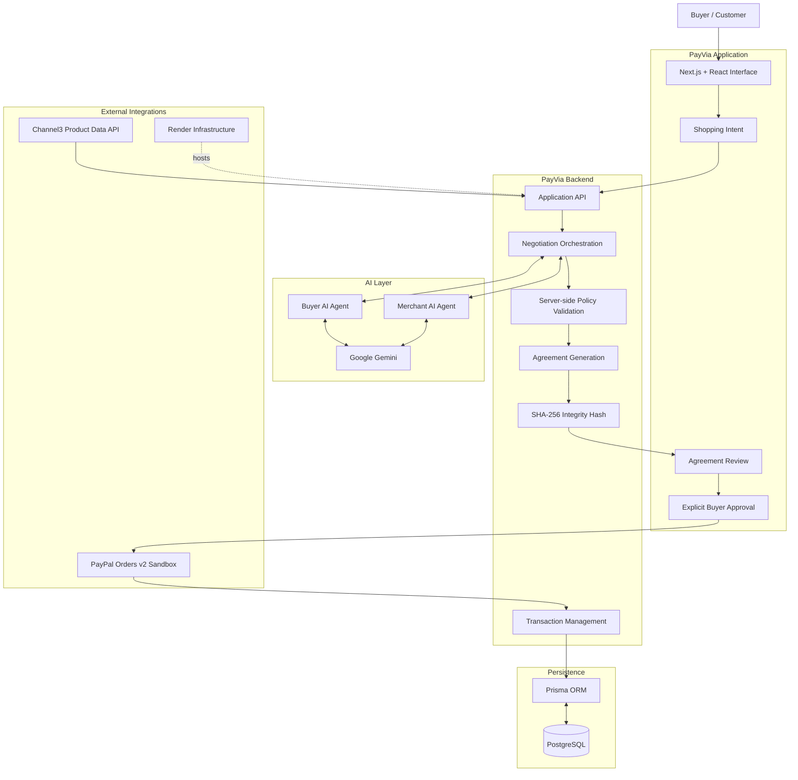
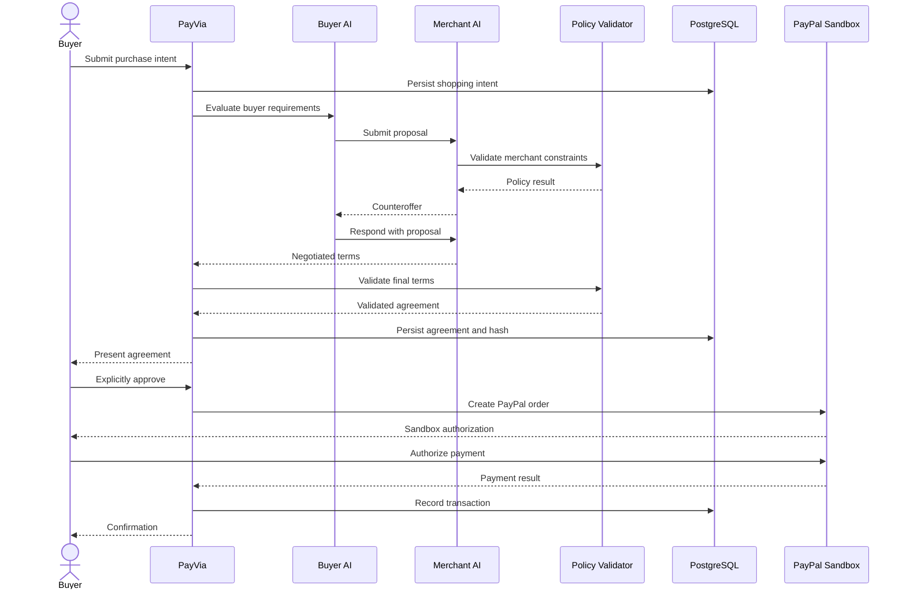
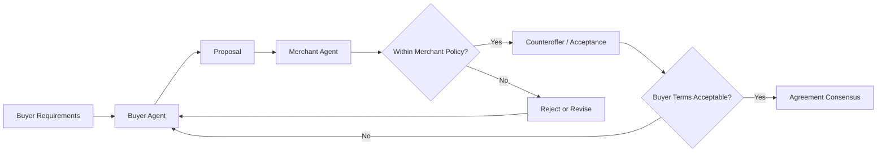
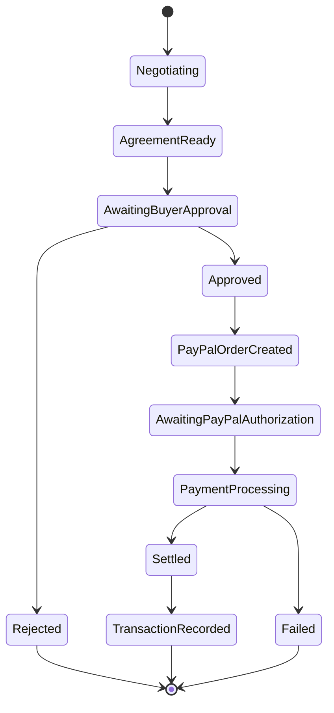
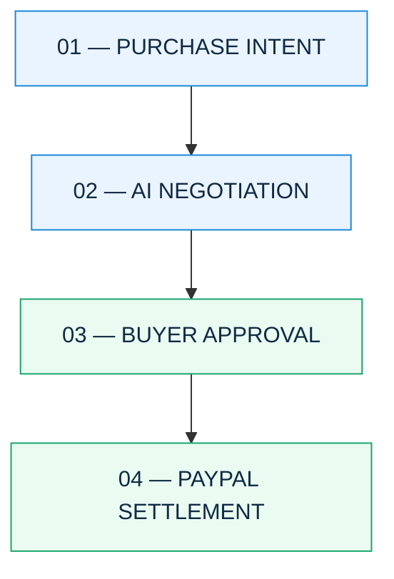
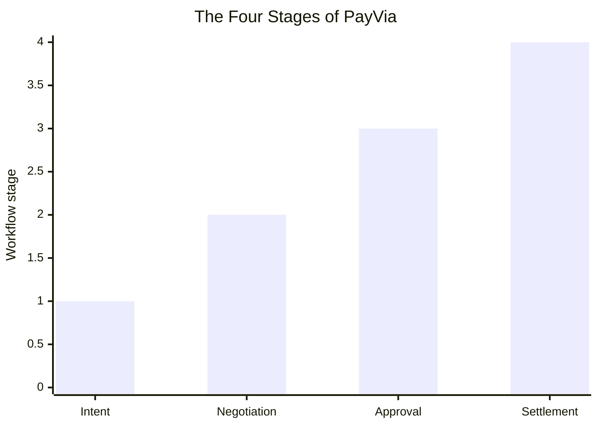

# ⚡ PayVia

<h3 align="center">AI Negotiates. PayPal Settles.</h3>

<p align="center">
  <strong>Reimagining online commerce through autonomous AI-to-AI negotiation.</strong>
</p>

<p align="center">
  
  
  
  
</p>

<p align="center">
  
  
  
  
  
</p>

<p align="center">
  <a href="#-overview">Overview</a> •
  <a href="#-how-it-works">How It Works</a> •
  <a href="#-architecture">Architecture</a> •
  <a href="#-paypal-integration">PayPal</a> •
  <a href="#-screenshots">Screenshots</a> •
  <a href="#-getting-started">Get Started</a>
</p>

---

## ✦ The Big Idea

**What if you never had to negotiate a purchase yourself again?**

Online shopping has evolved. Product discovery is faster, payments are easier, and marketplaces offer more choices than ever.

But one thing remains largely unchanged: buyers still have to compare prices, negotiate deals and settle for whatever terms a merchant offers.

We wanted to change that.

**PayVia introduces a new layer to digital commerce: AI agents negotiating directly with each other before a payment happens.**

A Buyer AI represents the customer's interests. A Merchant AI represents the seller's commercial interests. They exchange proposals, counteroffers and delivery commitments to reach mutually acceptable terms.

The buyer reviews the final agreement and explicitly approves it. PayPal then handles the payment settlement.

No AI independently authorizes a charge. No negotiation bypasses merchant-defined pricing boundaries.

Just a smarter way to reach a deal.

---

## 🚀 Overview

PayVia is an AI-powered, agent-to-agent commerce negotiation platform built for the **PayPal Hackathon**.

Instead of treating checkout as the first moment where a buyer and seller agree on commercial terms, PayVia moves negotiation before payment.

### The core concept

<details>
<summary><strong>How traditional shopping works</strong></summary>

```text
Browse Products
      ↓
Compare Prices
      ↓
Choose a Merchant
      ↓
Accept Listed Price
      ↓
Checkout
      ↓
Payment
```

The buyer does most of the comparison and decision-making manually.

</details>

<details>
<summary><strong>How PayVia changes the experience</strong></summary>

```text
Describe What You Need
         ↓
    Buyer AI Agent
         ↕
  AI Negotiation Layer
         ↕
   Merchant AI Agent
         ↓
 Negotiated Agreement
         ↓
  Buyer Approval
         ↓
  PayPal Settlement
```

The agents negotiate. The buyer remains in control. PayPal handles settlement.

</details>

---

## ✦ How It Works

PayVia follows a structured four-stage commerce workflow.

### 01 — Purchase Intent

The buyer describes the product they want and specifies their requirements.

- Product or item description
- Maximum purchase budget
- Preferred delivery window
- Additional purchase preferences

The buyer's budget and constraints are handled by the application and are not intended to be exposed to merchant agents.

### 02 — AI-to-AI Negotiation

Two AI agents participate in the negotiation.

| Buyer AI                          | Merchant AI                         |
| --------------------------------- | ----------------------------------- |
| Represents buyer requirements     | Represents merchant interests       |
| Evaluates proposals               | Evaluates buyer offers              |
| Considers budget constraints      | Considers merchant pricing policies |
| Generates counteroffers           | Responds with counteroffers         |
| Seeks acceptable commercial terms | Protects authorized margins         |

The agents exchange proposals until they reach an acceptable agreement or the negotiation cannot proceed.

### 03 — Agreement & Approval

Once consensus is reached, PayVia generates a structured commercial agreement.

The agreement includes:

- Product and merchant identity
- Final negotiated price
- Original listing price
- Savings
- Quantity and delivery commitment
- Settlement method
- Agreement integrity information

A SHA-256 hash is used to identify the canonical agreement terms and help verify their integrity.

**The buyer must explicitly approve the agreement before payment proceeds.**

### 04 — PayPal Settlement

After approval:

1. PayVia validates the approved agreement.
2. The backend initiates the PayPal Orders v2 workflow.
3. The buyer is redirected to PayPal Sandbox.
4. The buyer authorizes the payment.
5. PayVia processes and verifies the payment result.
6. The application records the transaction and displays confirmation.

---

## 🏗️ Architecture

PayVia separates AI negotiation, commercial validation, agreement approval and payment settlement.

### System architecture



### Negotiation sequence



---

## 🤖 The AI Layer

### Two agents. Two perspectives. One agreement.

PayVia uses Google Gemini to support the negotiation process.

Rather than using AI as a simple chatbot, PayVia gives the agents distinct commercial responsibilities.

#### Buyer Agent

The Buyer Agent works on behalf of the customer.

Its objectives include:

- Understanding the purchase intent.
- Considering the buyer's requirements.
- Evaluating merchant proposals.
- Generating offers and counteroffers.
- Seeking commercially acceptable terms.

#### Merchant Agent

The Merchant Agent represents the seller.

Its objectives include:

- Evaluating buyer proposals.
- Considering merchant pricing policies.
- Protecting authorized pricing boundaries.
- Responding with counteroffers.
- Reaching an acceptable commercial agreement.

### Negotiation model



AI assists with reasoning and proposal generation. Deterministic server-side validation remains responsible for enforcing financial and commercial constraints.

---

## 💳 PayPal Integration

### AI negotiates. PayPal settles.

PayPal is not just an additional checkout button in PayVia. It is the payment settlement layer that completes the negotiated commerce workflow.

PayVia integrates the **PayPal Developer Platform using PayPal Orders v2 in the Sandbox environment**.

### Payment lifecycle



### What the integration does

| Component                 | Responsibility                                  |
| ------------------------- | ----------------------------------------------- |
| PayPal Developer Platform | Developer and Sandbox environment               |
| PayPal Orders v2          | Order creation and payment workflow             |
| PayVia backend            | Server-side payment orchestration               |
| Buyer approval            | Explicit authorization to proceed               |
| Transaction records       | Persistence of payment-related application data |

### Financial separation

PayVia maintains a deliberate separation between negotiation and payment.

- AI agents cannot independently authorize payment.
- Merchant pricing boundaries are validated server-side.
- The final payment amount is bound to the approved commercial terms.
- The buyer must authorize the payment through PayPal.
- Payment confirmation must come from the actual payment workflow.

**Sandbox notice:** All payment demonstrations use PayPal Sandbox. No real-money transaction is represented by the demo.

---

## 🛡️ Security & Financial Safeguards

Financial boundaries are enforced independently of AI-generated reasoning.

| Safeguard              | Purpose                                             |
| ---------------------- | --------------------------------------------------- |
| Buyer budget ceiling   | Keeps proposals within the buyer's stated maximum   |
| Merchant pricing floor | Protects merchant-authorized minimum prices         |
| Server-side validation | Prevents AI output from bypassing commercial rules  |
| Explicit approval      | Requires buyer consent before proceeding to payment |
| SHA-256 hashing        | Identifies and verifies canonical agreement content |
| Persistent records     | Stores application and transaction information      |
| PayPal Sandbox         | Supports safe payment-flow testing                  |

### Agreement integrity

PayVia uses SHA-256 to calculate an integrity hash for the canonical agreement terms.

This allows the application to identify the agreement content and detect changes to those terms.

A hash alone does not prove that the buyer approved an agreement or that a payment occurred. Approval and payment are handled and verified through their respective workflows.

---

## 🧰 Technology Stack

PayVia brings together modern web development, AI infrastructure, database persistence and payment APIs.

| Technology                | Usage                                          |
| ------------------------- | ---------------------------------------------- |
| Next.js 15.1.7            | Web application framework                      |
| React 19                  | User interface                                 |
| TypeScript                | Type-safe application development              |
| Node.js 20.18.0           | Runtime                                        |
| PostgreSQL 18.6           | Relational database                            |
| Prisma 6.19.3             | ORM and database access                        |
| Google Gemini             | AI-powered negotiation                         |
| PayPal Orders v2          | Payment integration                            |
| Channel3 Product Data API | Product data integration                       |
| Render                    | Hosting and database infrastructure            |
| Docker Compose            | Local infrastructure configuration, where used |

### Sponsor and platform ecosystem

| Platform                  | How it contributes                 |
| ------------------------- | ---------------------------------- |
| PayPal Developer Platform | Payment settlement through Sandbox |
| Google Gemini             | Buyer and merchant AI negotiation  |
| Channel3                  | Product Data API integration       |
| Render                    | Application hosting and PostgreSQL |

Other sponsor tools should only be listed here if their actual integration is present in the source code.

---

## 📸 Screenshots

Explore the PayVia interface and its end-to-end commerce workflow.

> Add the genuine application screenshots to `docs/images/` using the filenames below. Replace or remove any image reference that does not exist in your repository.

### Landing page

<p align="center">
  
</p>

### Shopping intent

<p align="center">
  
</p>

### AI negotiation

<p align="center">
  
</p>

### Agreement review

<p align="center">
  
</p>

### PayPal settlement

<p align="center">
  
</p>

### Transaction confirmation

<p align="center">
  
</p>

### Fulfillment tracking

<p align="center">
  
</p>

---

## 📊 The PayVia Workflow at a Glance

The following diagram illustrates the project's four core stages.



The following chart is conceptual, not a measured performance benchmark.



---

## ⚙️ Getting Started

Want to explore PayVia locally? Follow these steps.

### Prerequisites

Before starting, make sure you have:

- Node.js 20.18.0 or a compatible supported version.
- npm.
- PostgreSQL.
- Google Gemini API credentials.
- PayPal Developer Sandbox credentials.
- Git.

### 1. Clone the repository

```bash
git clone <YOUR_PUBLIC_GITHUB_REPOSITORY_URL>
cd PayVia
```

### 2. Install dependencies

```bash
npm ci
```

### 3. Configure environment variables

Create a local environment file:

```bash
cp .env.example .env
```

Add your own credentials using the variable names documented in `.env.example`.

Typical integrations require:

| Variable                       | Purpose                                  |
| ------------------------------ | ---------------------------------------- |
| `DATABASE_URL`                 | PostgreSQL connection                    |
| `PAYPAL_CLIENT_ID`             | PayPal Sandbox client ID                 |
| `PAYPAL_CLIENT_SECRET`         | PayPal Sandbox secret                    |
| `GOOGLE_GENERATIVE_AI_API_KEY` | Gemini API access                        |
| `APP_URL`                      | Application URL, if required by the code |

Never commit your `.env` file or expose private credentials.

### 4. Generate Prisma client

```bash
npx prisma generate
```

### 5. Apply database migrations

```bash
npx prisma migrate deploy
```

Make sure your local PostgreSQL database is available and the connection string is configured correctly.

### 6. Start the development server

```bash
npm run dev
```

Open the local URL printed by the development server.

> Check the project's `package.json` and `.env.example` for the definitive scripts and environment variables before running these commands. Additional setup or seed steps may be required.

---

## 🧪 Testing

PayVia should be tested across its full workflow rather than only checking whether the landing page loads.

| Test area           | What to validate                                     |
| ------------------- | ---------------------------------------------------- |
| Shopping intent     | Valid purchase requests are created                  |
| AI negotiation      | Buyer and merchant proposals are processed           |
| Pricing constraints | Budget ceilings and merchant floors are enforced     |
| Agreement           | Negotiated terms are persisted and integrity-checked |
| Buyer approval      | Payment cannot proceed without approval              |
| PayPal              | Sandbox order and payment lifecycle                  |
| Persistence         | Transactions and application records are stored      |
| Fulfillment         | Order and delivery information is displayed          |

Use the actual test scripts configured in `package.json`.

---

## ☁️ Deployment

PayVia uses **Render** for application hosting and PostgreSQL infrastructure.

The repository includes deployment configuration through `render.yaml`.

Typical deployment flow:

```text
Git Repository
      ↓
Render Build
      ↓
Dependency Installation
      ↓
Production Build
      ↓
Database Migration
      ↓
Application Startup
      ↓
PayVia Web Application
```

### Deployment requirements

Configure the required environment variables securely in the Render dashboard.

- PostgreSQL connection string
- PayPal Sandbox credentials
- Gemini API key
- Application URL, if required

Never store production credentials in source control.

---

## 🗺️ Roadmap

PayVia is an early implementation of agent-driven commerce. The broader vision goes beyond a single buyer and merchant interaction.

| Area                       | Future direction                               |
| -------------------------- | ---------------------------------------------- |
| Multi-merchant negotiation | Compare negotiated terms across more merchants |
| Agent personalization      | More adaptable buyer preferences               |
| Merchant ecosystem         | Additional merchant and catalogue integrations |
| Negotiation intelligence   | More advanced negotiation strategies           |
| Fulfillment                | Richer order and delivery integrations         |
| Agent interoperability     | Broader support for agent-to-agent commerce    |

---

## 💡 What Makes PayVia Different?

Most shopping applications focus on product discovery and checkout.

PayVia explores what happens between those two moments.

It introduces negotiation as a first-class part of the commerce process, using AI agents to represent the interests of both sides.

The buyer does not surrender control of the transaction. The merchant does not surrender control of pricing policies. And payment is not initiated merely because an AI has reached a proposed agreement.

**The result is a structured approach to agent-driven commerce, with human approval and established payment infrastructure at its core.**

---

## 🏆 Built for the PayPal Hackathon

PayVia was developed as part of the PayPal Hackathon, exploring how generative AI and payment infrastructure can work together to create new commerce experiences.

The project brings together:

- Agentic AI.
- Buyer and merchant negotiation.
- Product discovery.
- Commercial agreement generation.
- Agreement integrity verification.
- Explicit buyer authorization.
- PayPal Sandbox payment settlement.

We believe the next evolution of online commerce will not just be about helping people find products.

It will be about helping them reach better agreements.

---

## 📄 License

This project is distributed under the license specified in the [`LICENSE`](LICENSE) file.

---

<p align="center">
  <h2>PayVia</h2>
  <strong>AI negotiates. PayPal settles.</strong>
  <br/><br/>
  <sub>Exploring the future of agent-to-agent commerce.</sub>
</p>
