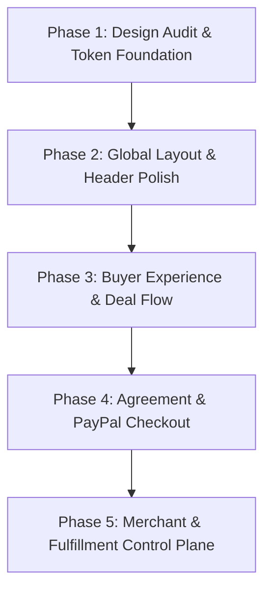

# PayVia UI/UX Overhaul — Phase 1: Product Design Audit

**Author:** Principal Product Designer, Senior Frontend Engineer, Design Systems Architect, Accessibility Engineer  
**Date:** October 25, 2026  
**Scope:** Comprehensive design, information-architecture, accessibility, and performance audit of the existing PayVia application in preparation for a production-quality visual overhaul.  
**Core Product Identity:** *"AI negotiates. PayPal settles."*

---

## 1. Current Route Inventory

The application is built on Next.js 15.1.7 (App Router). The complete inventory of primary customer and merchant routes is as follows:

| Route Path | Client/Server | Primary Responsibilities | Current Layout & Components |
|---|:---:|---|---|
| `/` | Server + Client | Public landing page, product value proposition, 3-step zero-trust explainer, and primary Shopping Intent composer. | `app/page.tsx`<br>• `ShoppingIntentExperience.tsx`<br>• `Header.tsx` |
| `/negotiate` | Client | Autonomous multi-turn agent negotiation room. Allows product selection, buyer constraints configuration ($ budget, SLA), and real-time agent exchange stream. | `app/negotiate/page.tsx`<br>• `ProductCard.tsx`<br>• `BuyerAgentPanel.tsx`<br>• `MerchantAgentPanel.tsx`<br>• `NegotiationTimeline.tsx` |
| `/agreement` | Client | Cryptographic agreement review, SHA-256 hash validation, savings breakdown, and explicit human approval gate. | `app/agreement/page.tsx`<br>• `AgreementCard.tsx`<br>• `SlideCommit.tsx` (optional slider) |
| `/checkout` | Client | PayPal Sandbox settlement authorization portal. Displays negotiated amount, itemized breakdown, and launches hosted approval. | `app/checkout/page.tsx`<br>• `PayPalCheckout.tsx` |
| `/checkout/success` | Client | Verified payment confirmation, capture ID receipt, delivery SLA guarantee, rating feedback, and Bryntum fulfillment link. | `app/checkout/success/page.tsx`<br>• `PeekRating.tsx` |
| `/merchant` | Client | Merchant control plane: revenue KPIs, policy floor configuration, catalog management, agent simulator, AG Grid transactions ledger, AG Studio analytics, and developer portal. | `app/merchant/page.tsx`<br>• `MerchantGrid.tsx` (dynamic)<br>• `MerchantStudioDashboard.tsx` (dynamic)<br>• `MerchantPolicyEditor.tsx` (dynamic)<br>• `MerchantAgentSimulator.tsx` (dynamic)<br>• `MerchantProductCatalog.tsx` (dynamic)<br>• `PayViaConnectDeveloper.tsx` (dynamic) |
| `/fulfillment` | Client | Operational delivery scheduling engine powered by Bryntum Gantt/Scheduler, task timeline breakdown, linehaul status, and AI logistics dispatcher. | `app/fulfillment/page.tsx`<br>• `BryntumScheduler.tsx`<br>• `FulfillmentHeader.tsx`<br>• `TaskBreakdownTable.tsx`<br>• `FulfillmentAiPanel.tsx` |
| `/memory` | Client | Elasticsearch Serverless commerce memory explorer, vector index health metrics, merchant discount pattern lookup, and seed trigger. | `app/memory/page.tsx`<br>• `MemoryCard.tsx` |

---

## 2. Shared Component Inventory

### 2.1 Core UI Primitives (`components/ui/`)
- `Button` (`components/ui/button.tsx`): Supports `primary`, `secondary`, `outline`, `ghost`, `paypal`, `destructive`, `default`.
- `Badge` (`components/ui/badge.tsx`): Supports `default`, `secondary`, `outline`, `success`, `warning`, `info`, `purple`, `error`, `destructive`.
- `Card`, `CardHeader`, `CardTitle`, `CardDescription`, `CardContent` (`components/ui/card.tsx`): Base container box with border and shadow.
- `Input` (`components/ui/input.tsx`): Standard styled HTML input with focus ring.
- `ToastProvider` / `useToast` (`components/ui/ToastProvider.tsx`): Global banner toast system with auto-dismiss.

### 2.2 Navigation Components (`components/navigation/`)
- `Header` (`components/navigation/Header.tsx`): Active global navbar mounted in `app/layout.tsx`. Contains desktop navigation links, live PayPal Sandbox badge, CTA button, and accessible slide-out mobile drawer with ESC key and scroll locking.
- `Navbar` (`components/navigation/Navbar.tsx`): **Orphaned / Unused.** Legacy duplicate header referencing `StaggeredMenu`.
- `GlobalDock` (`components/navigation/GlobalDock.tsx`): **Orphaned / Unused.** Floating bottom navigation dock previously removed from `app/layout.tsx` to streamline cognitive load.

### 2.3 Interactive & Domain Components
- `ShoppingIntentExperience` (`components/buyer/ShoppingIntentExperience.tsx`): 3-step inline deal finder (`INTENT` ➔ `DISCOVERING` ➔ `NEGOTIATING` ➔ `OFFERS`).
- `OfferComparisonTable` (`components/buyer/OfferComparisonTable.tsx`): Multi-merchant candidate cards comparing prices, delivery days, and AI status.
- `NegotiationTimeline` (`components/NegotiationTimeline.tsx`): Chat/timeline stream visualizing Buyer Agent vs. Merchant Agent counter-offers with collapsible reasoning bubbles.
- `AgreementCard` (`components/AgreementCard.tsx`): Formal terms card with SHA-256 seal and human approval action.
- `PayPalCheckout` (`components/PayPalCheckout.tsx`): Direct client component launching `/api/paypal/create-order` and redirecting to PayPal Sandbox.
- `ProductCard` / `ProductDiscovery` (`components/ProductCard.tsx`, `components/ProductDiscovery.tsx`): Catalog product cards and search filter.
- `MerchantAgentSimulator` (`components/merchant/MerchantAgentSimulator.tsx`): Interactive sandbox for testing merchant policy responses against synthetic buyer proposals.

### 2.4 React-Bits Library Components (`components/react-bits/`)
- `SlideCommit` (`SlideCommit.tsx`): Slider confirmation for agreement approval.
- `PeekRating` (`PeekRating.tsx`): 5-star animated feedback component on success page.
- `BranchedMenu` (`BranchedMenu.tsx`): Tree menu navigation widget.
- `LatticeLoader` (`LatticeLoader.tsx`): Animated mesh loader.
- `CodeSlots` (`CodeSlots.tsx`): Syntax highlighted tabbed code snippet display.
- `SwipeToast` (`SwipeToast.tsx`): Mobile swipeable toast container.
- `StaggeredMenu` (`StaggeredMenu.tsx`): **Unused.** Fullscreen overlay menu (~19.6 kB) currently disconnected from layouts.
- `Dock` (`Dock.tsx`): **Unused.** Heavy macOS-style dock component (~39.3 kB) disconnected from layouts.

---

## 3. Visual Inconsistencies & Usability Problems

### Verified Problems:
1. **Color Token Drift (`#003087` vs. `#101828` vs. `payvia-navy`):**
   - *Evidence:* In [app/page.tsx](file:///g:/PayVia/app/page.tsx), raw hex colors like `text-[#101828]`, `bg-[#F8FAFC]`, and `text-[#5C6678]` are hardcoded inline, whereas [app/merchant/page.tsx](file:///g:/PayVia/app/merchant/page.tsx) and [app/checkout/success/page.tsx](file:///g:/PayVia/app/checkout/success/page.tsx) use legacy class names like `text-payvia-navy`, `bg-payvia-blue`, and `text-payvia-success`.
   - *Problem:* `tailwind.config.ts` defines `brand.primary: "#003087"` and `fintech.text: "#111827"`, but does not define `payvia-navy` or `payvia-blue`. In Tailwind v3, undefined classes silently fall back or produce inconsistent computed styles.
2. **Badge Variant Clutter:**
   - *Evidence:* [components/ui/badge.tsx](file:///g:/PayVia/components/ui/badge.tsx) has 9 variants (`default`, `secondary`, `outline`, `success`, `warning`, `info`, `purple`, `error`, `destructive`), many with overlapping visual aesthetics (e.g., `info` and `secondary` both use `#EFF8FF` background).
   - *Problem:* Visual badges lack strict semantic meaning. For example, "AI Negotiated" appears as `success` on `/agreement`, but as `info` or `secondary` in merchant simulator tabs.
3. **Card Border Radius Inconsistency:**
   - *Evidence:* [components/ui/card.tsx](file:///g:/PayVia/components/ui/card.tsx) uses `rounded-xl` (12px), while [app/page.tsx](file:///g:/PayVia/app/page.tsx) uses `rounded-2xl` (16px), and modal overlays use `rounded-3xl` (24px).
   - *Problem:* Visual rhythm feels disjointed across page transitions.
4. **Header vs. Content Alignment:**
   - *Evidence:* In [app/layout.tsx](file:///g:/PayVia/app/layout.tsx), `<main>` has `max-w-7xl px-4 sm:px-6`, matching the header. However, several internal cards on `/agreement` and `/checkout` use `max-w-2xl mx-auto`, creating an abrupt center-squish without clear breadcrumbs.

---

## 4. Navigation & Information Architecture Issues

### Verified Problems:
1. **Dead Legacy Navigation Files in Repository:**
   - *Evidence:* [components/navigation/Navbar.tsx](file:///g:/PayVia/components/navigation/Navbar.tsx) and [components/navigation/GlobalDock.tsx](file:///g:/PayVia/components/navigation/GlobalDock.tsx) remain in the codebase and import large dependencies (`StaggeredMenu.tsx` 19.6 kB, `Dock.tsx` 39.3 kB), even though [app/layout.tsx](file:///g:/PayVia/app/layout.tsx) exclusively mounts `Header.tsx`.
   - *Problem:* Developers or new routes may inadvertently re-import these legacy components, bloating bundle sizes and introducing conflicting navigation models.
2. **Homepage Navigation Disconnect:**
   - *Evidence:* The header has "Shop" pointing to `/negotiate`. The homepage features `ShoppingIntentExperience`, which is also a shopping interface. A buyer visiting `/` sees the intent form, but clicking "Shop" in the header jumps to `/negotiate`, which presents an older manual single-product selection screen.
   - *Recommendation:* Align `/negotiate` and `/` so that buyer intent discovery is the canonical shopping journey.

---

## 5. Buyer Journey Friction Points

### Verified Friction:
1. **Dual Negotiation Models (`ShoppingIntentExperience` vs. `NegotiateContent`):**
   - *Evidence:*
     - Model A ([components/buyer/ShoppingIntentExperience.tsx](file:///g:/PayVia/components/buyer/ShoppingIntentExperience.tsx)): User enters natural search term ➔ Channel3 discovers candidates ➔ parallel multi-merchant negotiation ➔ multi-offer comparison ➔ agreement.
     - Model B ([app/negotiate/page.tsx](file:///g:/PayVia/app/negotiate/page.tsx)): User picks from 3 hardcoded sample products (Laptop, Headphones, Watch) ➔ single merchant negotiation stream ➔ agreement.
   - *Friction:* A buyer navigating through the app encounters two competing mental models. Model A is vastly superior and reflects the autonomous multi-merchant protocol, while Model B feels like an early developer prototype.
2. **Agreement Review Cognitive Overload:**
   - *Evidence:* In [components/AgreementCard.tsx](file:///g:/PayVia/components/AgreementCard.tsx), the user is presented with both a standard button and an experimental slide-to-confirm widget (`SlideCommit.tsx`).
   - *Friction:* On mobile devices, horizontal slide-to-confirm conflicts with browser back/forward swipe gestures and screen scrolling. A clear, high-contrast, accessible primary button is significantly more trustworthy for a financial transaction.

---

## 6. Merchant Dashboard Usability Issues

### Verified Problems:
1. **Tab Proliferation (7 Tabs):**
   - *Evidence:* In [app/merchant/page.tsx](file:///g:/PayVia/app/merchant/page.tsx#L100), the dashboard presents 7 tabs: `overview`, `products`, `policy`, `simulator`, `transactions`, `analytics`, `developer`.
   - *Problem:* The tabs wrap on tablet viewports and clutter the header area.
2. **Information Duplication:**
   - *Evidence:* `transactions` (AG Grid) and `analytics` (AG Studio) overlap in purpose.
   - *Recommendation:* Consolidate into 4 core sections:
     - **Control Plane:** Overview KPIs & Real-Time Settlements.
     - **Negotiation Policy:** Margin floor, delivery constraints, and simulator.
     - **Product Catalog:** Inventory, pricing, and stock status.
     - **Developer Portal:** Webhooks, API keys, and SDK references.

---

## 7. Accessibility & Responsive Design Gaps

### Verified Problems:
1. **Color Contrast in Subdued Text:**
   - *Evidence:* Several elements use `text-muted-foreground` or `#94A3B8` on white surfaces (e.g., subtitle text and timestamps in [NegotiationTimeline.tsx](file:///g:/PayVia/components/NegotiationTimeline.tsx)).
   - *Problem:* Light slate `#94A3B8` on white `#FFFFFF` has a contrast ratio of **2.5:1**, failing WCAG 2.1 AA (minimum 4.5:1 for normal text).
2. **Keyboard Focus States:**
   - *Evidence:* In [components/ui/button.tsx](file:///g:/PayVia/components/ui/button.tsx), focus rings use `focus:ring-[#0070E0] focus:ring-offset-2`. While good, custom div cards with `cursor-pointer` (like the quick cards on the merchant overview) lack `tabIndex={0}`, `role="button"`, and `onKeyDown` handlers, making them completely inaccessible to keyboard-only users.
3. **Motion Preferences:**
   - *Evidence:* While basic `@media (prefers-reduced-motion)` exists in `globals.css`, animated spinners like `animate-spin` in [app/negotiate/page.tsx](file:///g:/PayVia/app/negotiate/page.tsx) and [app/fulfillment/page.tsx](file:///g:/PayVia/app/fulfillment/page.tsx) continue spinning continuously without honoring reduced-motion settings.

---

## 8. Performance & Asset Opportunities

### Verified Metrics:
- **Production Build Baseline:**
  - Route `/`: 177 kB first load JS.
  - Route `/merchant`: 127 kB first load JS (already dynamically split via `next/dynamic` in Phase G).
  - Shared initial chunks: 106 kB.
- **Unused Library Overhead:**
  - `components/react-bits/Dock.tsx` is 39.3 kB and unused in active layouts.
  - `components/react-bits/StaggeredMenu.tsx` is 19.6 kB and unused in active layouts.
  - Eliminating or pruning unused components prevents inadvertent bundle bloat and keeps the build tree minimal.

---

## 9. Proposed Design Tokens & Component Conventions

To achieve a distinctive, trustworthy fintech aesthetic ("AI negotiates. PayPal settles."), the following design system tokens are proposed:

### 9.1 Color Palette Tokens (WCAG AA & AAA Compliant)
```css
:root {
  /* Surfaces: Crisp white & restrained soft neutrals */
  --surface-base: #FFFFFF;
  --surface-subtle: #F8FAFC;
  --surface-muted: #F1F5F9;
  --surface-card: #FFFFFF;
  --border-subtle: #E2E8F0;
  --border-strong: #CBD5E1;

  /* Typography: Deep trustworthy navy & slate */
  --text-primary: #0A192F;      /* Deep Midnight Navy (Contrast 15.8:1) */
  --text-secondary: #475569;    /* Refined Slate (Contrast 5.4:1) */
  --text-muted: #64748B;        /* Muted Label (Contrast 4.6:1) */

  /* Brand Accents: Restrained Fintech Blue */
  --brand-navy: #002266;        /* Primary button base & dark emphasis */
  --brand-blue: #0052CC;        /* Interactive link & focus states */
  --brand-sky: #EBF3FF;         /* Subtle accent badges */

  /* Functional Semantics */
  --status-success-text: #0E6245;
  --status-success-bg: #ECFDF5;
  --status-success-border: #A7F3D0;

  --status-warning-text: #92400E;
  --status-warning-bg: #FFFBEB;
  --status-warning-border: #FDE68A;

  --status-error-text: #991B1B;
  --status-error-bg: #FEF2F2;
  --status-error-border: #FECACA;
}
```

### 9.2 Typography Hierarchy
- **Font Stack:** Clean system sans-serif (`-apple-system, BlinkMacSystemFont, "Segoe UI", Roboto, "Inter", sans-serif`).
- **Heading 1:** `text-3xl sm:text-4xl lg:text-5xl font-extrabold tracking-tight text-[#0A192F]`.
- **Heading 2:** `text-xl sm:text-2xl font-bold tracking-tight text-[#0A192F]`.
- **Heading 3:** `text-base sm:text-lg font-semibold text-[#0A192F]`.
- **Body Regular:** `text-sm text-[#475569] leading-relaxed`.
- **Financial Monospace:** `font-mono font-bold tracking-tight`.

### 9.3 Restrained Motion & Surfaces
- **Borders:** Clean `1px solid var(--border-subtle)`. No thick gaudy strokes.
- **Shadows:** Restrained elevation (`shadow-xs` for cards, `shadow-sm` for active dropdowns). Avoid heavy blurred drop-shadows.
- **Gradients:** Restrict gradients to subtle top accent stripes (`h-1` brand bar on major transaction cards). Zero full-card or neon background gradients.

---

## 10. Prioritized Redesign Implementation Plan

To ensure zero downtime, preserve all payment security controls, and keep all 150 automated tests passing, the overhaul is divided into 5 small, verifiable phases:



### Phase 2: Design Token Foundation & Global Layout (Non-breaking)
- Consolidate `tailwind.config.ts` with the unified token palette (`brand`, `surface`, `fintech`, `text`).
- Standardize [app/globals.css](file:///g:/PayVia/app/globals.css) and clean up conflicting utility classes.
- Polish [components/navigation/Header.tsx](file:///g:/PayVia/components/navigation/Header.tsx) with crisp typography, accurate active link states, and remove references to orphaned navigation files.
- Verify accessibility contrast and keyboard navigation.

### Phase 3: Canonical Buyer Journey & Homepage Unification
- Unify the shopping experience: ensure the homepage `ShoppingIntentExperience` seamlessly connects to the candidate offer comparison and negotiation stream without mental-model dissonance.
- Refactor [components/buyer/ShoppingIntentExperience.tsx](file:///g:/PayVia/components/buyer/ShoppingIntentExperience.tsx) and [components/buyer/OfferComparisonTable.tsx](file:///g:/PayVia/components/buyer/OfferComparisonTable.tsx) to use the new white/navy/blue design tokens.
- Update [NegotiationTimeline.tsx](file:///g:/PayVia/components/NegotiationTimeline.tsx) to provide high-clarity chat bubbles with clean agent avatars and readable reasoning toggles.

### Phase 4: Agreement Review & PayPal Sandbox Settlement
- Redesign [components/AgreementCard.tsx](file:///g:/PayVia/components/AgreementCard.tsx): replace the experimental slider with an authoritative, accessible primary approval button and crisp cryptographic seal badges.
- Standardize [app/checkout/page.tsx](file:///g:/PayVia/app/checkout/page.tsx) and [components/PayPalCheckout.tsx](file:///g:/PayVia/components/PayPalCheckout.tsx) with clear financial itemization.
- Refine [app/checkout/success/page.tsx](file:///g:/PayVia/app/checkout/success/page.tsx) with clean transaction receipt cards and a direct handoff to fulfillment.

### Phase 5: Merchant Dashboard, Fulfillment & AI Memory
- Consolidate [app/merchant/page.tsx](file:///g:/PayVia/app/merchant/page.tsx) tabs from 7 into 4 streamlined sections.
- Update [components/fulfillment/BryntumScheduler.tsx](file:///g:/PayVia/components/fulfillment/BryntumScheduler.tsx) header and timeline cards with consistent typography and badges.
- Polish [app/memory/page.tsx](file:///g:/PayVia/app/memory/page.tsx) search inputs and memory cards with high-contrast metadata tags.
- Run complete regression: `npm run typecheck`, `npm run lint`, `npm test` (150/150), and `npm run build`.

---

## 11. Final Audit Conclusion

The PayVia codebase has robust underlying mechanics (150 passing invariant tests, server-side agreement hashing, real PayPal Sandbox REST v2 integration, and zero security leaks). The existing visual interface, however, suffered from evolutionary design drift—competing navigation prototypes, conflicting color classes, and duplicate buyer negotiation models.

By implementing the unified design tokens and 5-phase plan documented in this audit, PayVia will achieve a cohesive, trustworthy fintech aesthetic that proudly delivers on its promise: **"AI negotiates. PayPal settles."**
