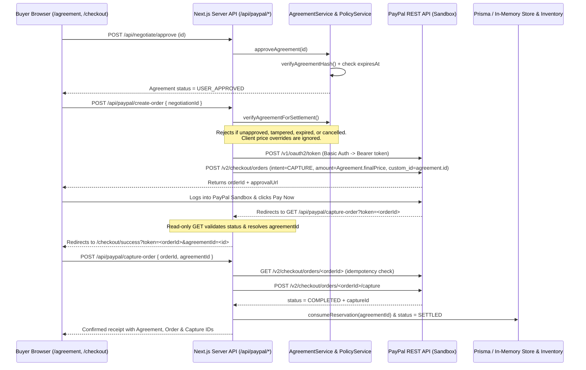

# PayVia PayPal Integration & Payment Settlement Flow

PayVia uses **PayPal Orders v2** on the **PayPal Sandbox** (`https://api-m.sandbox.paypal.com`) for payment settlement. No live money moves in this hackathon configuration. AI agents propose commercial terms during negotiation, while PayPal order creation and capture occur only on the server after cryptographic agreement validation and explicit buyer approval.

---

## 1. End-to-End Settlement Architecture

---

## 2. PayPal Developer Platform Implementation Details

### 2.1 Environment & OAuth2 Token Management ([`lib/paypal/auth.ts`](../lib/paypal/auth.ts))

- `getPayPalBaseUrl()` switches between `https://api-m.sandbox.paypal.com` (`PAYPAL_ENVIRONMENT=sandbox`, default) and `https://api-m.paypal.com` (`production`).
- `getPayPalAccessToken()` sends `grant_type=client_credentials` with HTTP Basic authentication (`PAYPAL_CLIENT_ID:PAYPAL_CLIENT_SECRET`) to `POST /v1/oauth2/token` strictly on the server.
- Access tokens are cached in memory and refreshed automatically when within 60 seconds of expiry.
- [`lib/paypal/client.ts`](../lib/paypal/client.ts) (`paypalRequest<T>()`) injects `Authorization: Bearer <token>` and logs structured PayPal API errors (`name`, `message`, `debug_id`) server-side without forwarding secrets to the browser.

> **Package Note:** While `@paypal/agent-toolkit` appears in [`package.json`](../package.json), the runtime checkout and webhook pipelines communicate directly with PayPal's official REST API (`v1/oauth2`, `v2/checkout/orders`, and `v1/notifications`) via [`lib/paypal/`](../lib/paypal/orders.ts).

---

### 2.2 Server-Side Pre-Settlement Verification ([`lib/services/agreement.service.ts`](../lib/services/agreement.service.ts))

Before any PayPal order is initiated, `AgreementService.verifyAgreementForSettlement()` enforces five deterministic invariants:

1. **Cryptographic Integrity (`verifyAgreementHash`):** Recomputes canonical sorted-JSON `SHA-256` over immutable terms (`id`, `transactionId`, `negotiationId`, `platformId`, `merchantId`, `buyerId`, `currency`, line items, `originalPrice`, `finalPrice`, `deliveryDays`, `paymentTiming`) and compares with `crypto.timingSafeEqual()`. Rejects with `HASH_VERIFICATION_FAILED` on mismatch.
2. **Price Ceiling & Positivity:** Rejects if `finalPrice > originalPrice` (`PRICE_CEILING_VIOLATION`) or `finalPrice <= 0` (`INVALID_AMOUNT`).
3. **Expiration Boundary:** Requires a valid `expiresAt` ISO timestamp and rejects when `now >= expiresAt` (`AGREEMENT_EXPIRED`, `MISSING_EXPIRATION`, or `MALFORMED_EXPIRATION`).
4. **Terminal State Guards:** Rejects `CANCELLED` or unaccepted `DRAFT` agreements.
5. **Explicit Human Buyer Approval:** Rejects unapproved agreements with `USER_APPROVAL_REQUIRED` unless `Agreement.status === "USER_APPROVED"` or `"SETTLED"`.

---

### 2.3 Order Creation & Client Price Immunity

- **UI Handoff ([`components/PayPalCheckout.tsx`](../components/PayPalCheckout.tsx)):** Sends only `negotiationId` to `POST /api/paypal/create-order` — client-supplied price or amount fields are never trusted.
- **API Route ([`app/api/paypal/create-order/route.ts`](../app/api/paypal/create-order/route.ts)):** Calls `assertServerEnv({ requireMerchantEmail: true })`, resolves the canonical `Agreement` by `agreementId`, `negotiationId`, or `transactionId` in [`agreementRepo`](../lib/repositories/index.ts) (falling back to [`negotiation-store.ts`](../lib/ai/negotiation-store.ts)), validates all invariants, and invokes `createPayPalOrder()` using `agreement.finalPrice` (when called with an agreement/negotiation ID). *(A standalone `bodyData.amount` branch exists only when no `negotiationId`/`agreementId` is provided for direct sandbox endpoint testing.)*
- **Domain Service ([`lib/services/settlement.service.ts`](../lib/services/settlement.service.ts) & [`lib/providers/settlement/paypal.provider.ts`](../lib/providers/settlement/paypal.provider.ts)):** For `/api/v1/agreements/:id/settle`, `SettlementService.initiateSettlement()` validates the agreement, avoids duplicating already-`CAPTURED` settlements, persists a `PENDING` `Settlement` record with `provider = "PAYPAL_ORDERS_V2"`, binds `amount = agreement.finalPrice`, and logs a `SETTLEMENT_REQUESTED` audit event.
- **PayPal Payload ([`lib/paypal/orders.ts`](../lib/paypal/orders.ts)):** `createPayPalOrder()` creates an order with `intent: "CAPTURE"`, sets `purchase_units[0].custom_id = agreement.id`, attaches `payee.email_address = PAYPAL_MERCHANT_EMAIL`, sets `application_context.user_action = "PAY_NOW"`, and configures `return_url` (`/api/paypal/capture-order`) and `cancel_url` (`/api/paypal/cancel`).

---

### 2.4 Buyer Authorization & Cancellation

- After order creation returns `approvalUrl`, the buyer is redirected to PayPal Sandbox to sign in with a Sandbox personal buyer account and authorize payment.
- If the buyer cancels on PayPal, PayPal redirects to `GET /api/paypal/cancel` ([`app/api/paypal/cancel/route.ts`](../app/api/paypal/cancel/route.ts)), which returns the buyer to `/checkout?payment=cancelled` without altering agreement terms or charging funds.

---

### 2.5 Read-Only Return Routing vs. Authoritative Capture

PayVia separates safe HTTP `GET` redirect handling from state-changing `POST` capture execution:

1. **Read-Only Redirect (`GET /api/paypal/capture-order` in [`app/api/paypal/capture-order/route.ts`](../app/api/paypal/capture-order/route.ts)):**
   - Receives `?token=<orderId>` when PayPal returns the buyer's browser.
   - Never captures or mutates funds during `GET`; performs a read-only `getPayPalOrder(token)` lookup to resolve `custom_id` (`agreementId`) and check if already `COMPLETED`.
   - Redirects to `/checkout/success?token=<orderId>&agreementId=<id>` (or passes `status=COMPLETED` if already captured).
2. **Idempotent Server Capture (`POST /api/paypal/capture-order` & [`app/checkout/success/page.tsx`](../app/checkout/success/page.tsx)):**
   - `/checkout/success` uses a `capturedTokenRef` guard to prevent duplicate capture submissions in React Strict Mode and triggers `POST /api/paypal/capture-order`.
   - The server calls `getPayPalOrder(orderId)` first; if `status === "COMPLETED"`, it returns the existing `captureId` idempotently without re-capturing.
   - Otherwise, `capturePayPalOrder(orderId)` posts to `/v2/checkout/orders/:id/capture`.
   - When `status === "COMPLETED"`, PayVia marks the canonical `Agreement` as `SETTLED` (`settledAt` timestamp), consumes the inventory stock lock via `catalogRepo.consumeReservation()`, and triggers non-blocking memory indexing.

---

### 2.6 Webhook Signature Verification & Deduplication ([`app/api/v1/webhooks/paypal/route.ts`](../app/api/v1/webhooks/paypal/route.ts))

Inbound notifications to `POST /api/v1/webhooks/paypal` undergo strict verification:

1. **Header Completeness Check:** Rejects (`400 MISSING_VERIFICATION_HEADERS`) if any of the 5 PayPal transmission headers (`paypal-auth-algo`, `paypal-cert-url`, `paypal-transmission-id`, `paypal-transmission-sig`, `paypal-transmission-time`) is missing.
2. **Cryptographic Verification (`verifyPayPalWebhookSignature()`):** Forwards headers, payload, and server `PAYPAL_WEBHOOK_ID` to `POST /v1/notifications/verify-webhook-signature`. Rejects (`401 WEBHOOK_SIGNATURE_VERIFICATION_FAILED`) unless `verification_status === "SUCCESS"`.
3. **Event Deduplication:** Checks [`idempotencyService`](../lib/services/idempotency.service.ts) (`scope: "webhooks:paypal"`) by event ID before calling `settlementService.captureSettlement(orderId)` on `CHECKOUT.ORDER.COMPLETED` or `PAYMENT.CAPTURE.COMPLETED`, preventing replay double-execution.

---

## 3. Verification Test Coverage

- `npx tsx scripts/run-tests.mjs`: Validates PayPal payload amount integrity (`Test 9`, `Test 10`) and Phase 4 settlement lifecycle safety gates (`Phase 4 Invariants 1–4`).
- `npm test`: Exercises webhook missing-header rejection, `verify-webhook-signature` validation, replay idempotency, expired/tampered/unapproved agreement rejection, `create-order` price lock, and `capture-order` reservation consumption (`Tests 59–64, 81, 100, 103–116, 134–140, 148`).

